<div align="center">

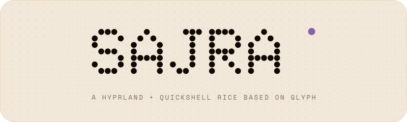

**sajra-rice** · my Hyprland + Quickshell desktop, ready to install on another machine.<br>
Based on [glyph-rice](https://github.com/Nebelung-cloud/glyph-rice), [Caelestia](https://github.com/caelestia-dots/shell) and others
(see [Based on](#based-on)).

<br>

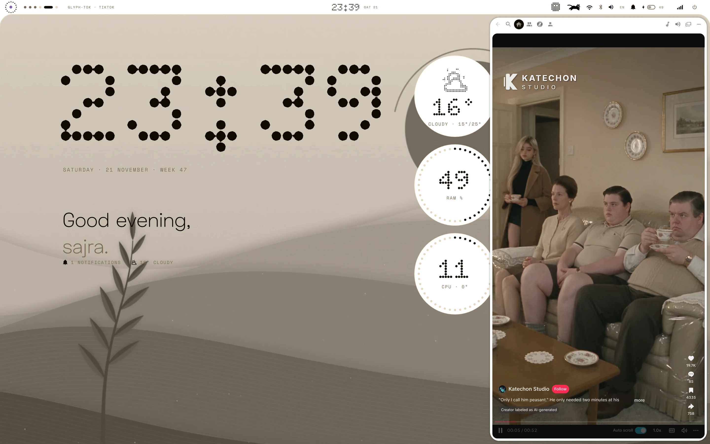

</div>

<div align="center"></div>

<h2 align="center">Based on</h2>

This rice is not built from scratch. It stands on the work of these projects, and keeps their history and licenses:

| Project | What it gives this rice |
|---|---|
| [**glyph-rice**](https://github.com/Nebelung-cloud/glyph-rice) by Nebelung and contributors (GPL-3.0) | The base: the Quickshell shell, Hyprland config, installer, login theme, fonts and the Nothing OS look. Its full history is in this repository. |
| [**Caelestia**](https://github.com/caelestia-dots/shell) | The model glyph-rice follows for the deck, hardware detection, optional components and where the colour comes from (wallpaper, Material You, palettes). |
| [**Demon's Shot**](https://github.com/Nebelung-cloud/demons-shot-rice) | glyph's sibling rice; `rice switch` changes between them. |
| [**Roamies**](https://github.com/KenKaiii/Roamies) by Ken Kai (AGPL-3.0-only) | The base of **Hanami**, the desktop assistant in [`hanami/`](hanami/). |
| [**Qodi Music**](https://github.com/cbranty/qodi-music) | The self-hosted music server the music panel can stream from (a separate project). |
| [Nothing OS](https://nothing.tech), [Doto](https://github.com/oliverlalan/Doto), [Gadgetbridge](https://codeberg.org/Freeyourgadget/Gadgetbridge) | The look and the Glyph lights, the dot matrix font, the earbuds protocol in `glyph/ear`. |

<h2 align="center">What sajra-rice adds</h2>

| | | |
|---|---|:---:|
| **Hanami** | voice assistant that lives on the desktop: talk, dictate into any app, reminders, finance overview, desktop control; its settings open as a native glyph side panel | `Ctrl` `Alt` `Space` · `Ctrl` `Alt` `H` |
| **Music** | music panel: library by albums or folders, search, shuffle and repeat, plays through `mpv` in the background (MPRIS, media keys). **Local** plays `~/Music`; **Server** streams from a [Qodi Music](https://github.com/cbranty/qodi-music) server, with login and library folder in its settings | `Super` `Alt` `M` · `Super` `M` play/pause |
| **glyph-tok** | TikTok, Netflix, Crunchyroll or Dailymotion in a glyph-styled phone window, docked on the right of every workspace (or floating, or in a corner the tiles wrap around), with Brave's ad blocker; `Super` `↑`/`↓` change videos while it shows. Source in [`apps/glyph-tok/`](apps/glyph-tok/) | `Super` `Alt` `T` |
| **Downloads** | aria2-based download manager panel (`glyph-dl`) | |
| **Speakers** | Prefs → SPEAKERS: Dolby-style profiles, 8-band EQ, loudness and balance, driven by [x1sound](x1sound/) | `Super` `I` |
| **Mixer** | per-app volume on the volume slider's right click | |
| **Vault** | Vaultwarden password picker (rbw + rofi) | `Super` `Alt` `P` |
| **Keys** | keystroke overlay in glyph style | `Super` `Alt` `K` |
| **Power** | battery charge limit dial (`glyph-charge-setup`), caffeine that holds a logind idle/sleep lock and survives restarts | |
| **Lock** | unlock with the fingerprint alongside the password; ThinkPads light the LED by the reader | `Super` `L` |
| **Layout** | per-monitor scaling, bar styles, window opacity and blur in Prefs | |
| **Theme** | light mode reaches GTK, Qt and the system colour scheme | |
| **VPN** | Cloudflare WARP for the VPN toggle when it's installed | |
| **Stats** | Intel GPU load and CPU temperature on Home | |
| **Prompt** | a Pure-style starship prompt for fish (`config/starship/starship-pure.toml`) | |

<h2 align="center">Repository layout</h2>

| Path | What it is |
|---|---|
| `config/` | the rice: Hyprland, Quickshell (glyph shell and its panels), kitty, fish, rofi, fonts, sddm theme, scripts in `config/bin` |
| `install.sh` | guided installer for Arch (see [Install](#install)) |
| `apps/glyph-tok/` | glyph-tok's source (C++/QML on Qt WebEngine, adblock-rust); `install.sh --with tok` builds it |
| `hanami/` | Hanami's source (Tauri + Node sidecar), AGPL-3.0-only, with its own [README](hanami/README.md) and [NOTICE](hanami/NOTICE) |
| `packaging/hanami-bin/` | PKGBUILD that repacks Hanami's `.deb` for Arch |
| `x1sound/` | speaker controller for the ThinkPad X1 Carbon Gen 9 (Rust daemon, PipeWire DSP chain, udev); hardware-specific, installed by hand ([README](x1sound/README.md)) |
| `system/` | system files outside `$HOME` the installer applies when they fit the machine |

<div align="center"></div>

<h2 align="center">What's inside</h2>

| | | |
|---|---|:---:|
| **Bar** | launcher, workspaces, clock, tray | |
| **Home** | clock, greeting, widgets (cava as a round Glyph Matrix), dot grid | |
| **Glyph** | screen edges as OSD: volume, brightness, notifications, progress | |
| **Launcher** | apps, style, windows, calculator | `Super` |
| **Quick** | quick settings, game mode, media, notifications; also opens from the right edge | `Super` `A` |
| **Deck** | dashboard from the bottom edge | `Super` `Space` |
| **Prefs** | settings, bar and home layout, audio devices | `Super` `I` |
| **Shot** | screenshots, editor, recording | `Print` |
| **Clip** | clipboard history | `Super` `V` |
| **Charms** | emoji, kaomoji, symbols | `Super` `.` |
| **Walls** | wallpapers as dots | `Super` `Shift` `W` |
| **VPN** | Clash Verge panel | `Super` `P` |
| **Cal** | calendar, focus timer | click the clock |
| **Buds** | Nothing / CMF earbuds: battery, ANC | |
| **Power** | power menu | `Super` `Esc` |
| **Lock** | lock screen | `Super` `L` |
| **Login** | SDDM theme: sessions on a camera dial, a Glyph tachometer that fills as you type, a staged power-on | `←` `→` |
| **Style** | where the colour comes from, like caelestia: Nothing (black, white, red), the wallpaper (one of its tones through a Material You variant — monochrome, neutral, tonal spot, rainbow, content, fidelity, fruit salad, expressive, vibrant) or a palette — Catppuccin, Rosé Pine, Gruvbox, Nord, Dracula, Tokyo Night, Everforest, Kanagawa. Shell, Hyprland and kitty follow at once, GTK and Qt apps when they next start | launcher → style, Prefs → Style (a live mock-up of the desktop shows the palette under the cursor before you pick it) |
| **Rice** | shell switcher, if Demon's Shot is installed too | `rice switch <name>` |

Also: Hyprland (Lua), hypridle, kitty, fish, starship, fastfetch, btop, cava (dots in fish; `command cava` for bars), GTK, Qt and folder colours.

<div align="center"></div>

<h2 align="center">Screenshots</h2>

| | |
|:---:|:---:|
| 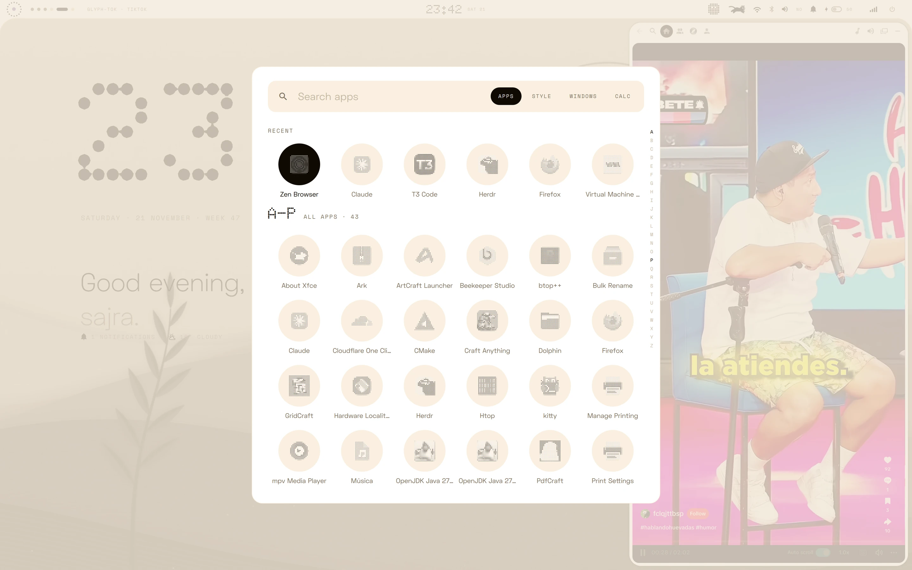 **Launcher** | 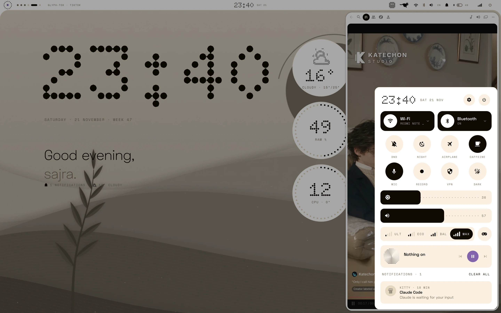 **Quick** |
| 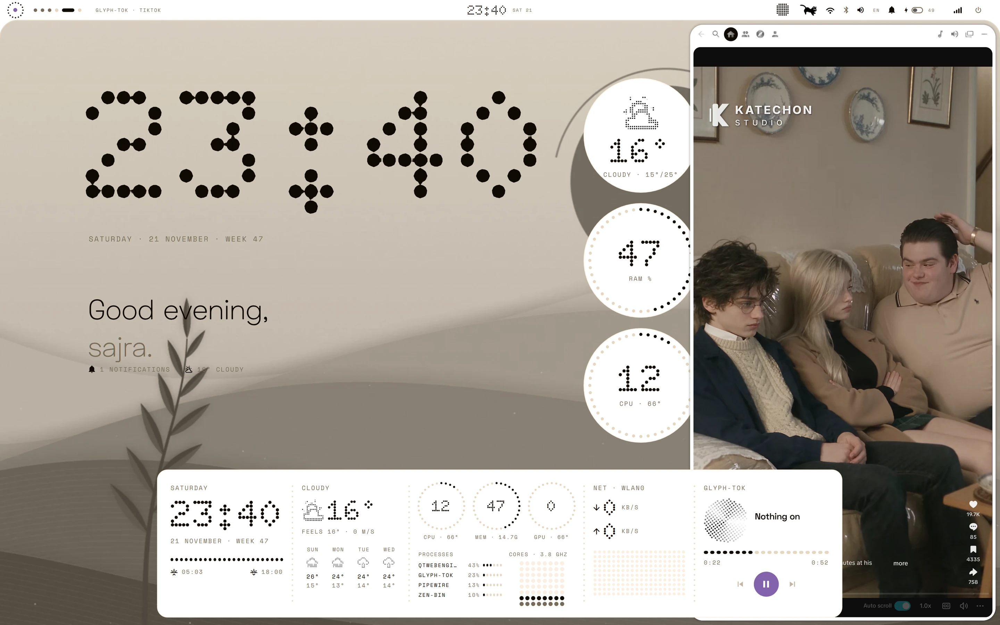 **Deck** | 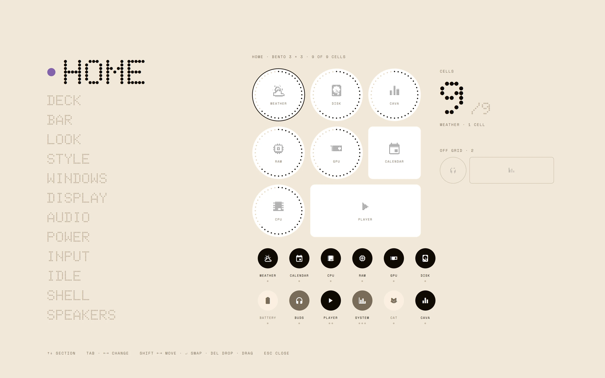 **Prefs** |
| 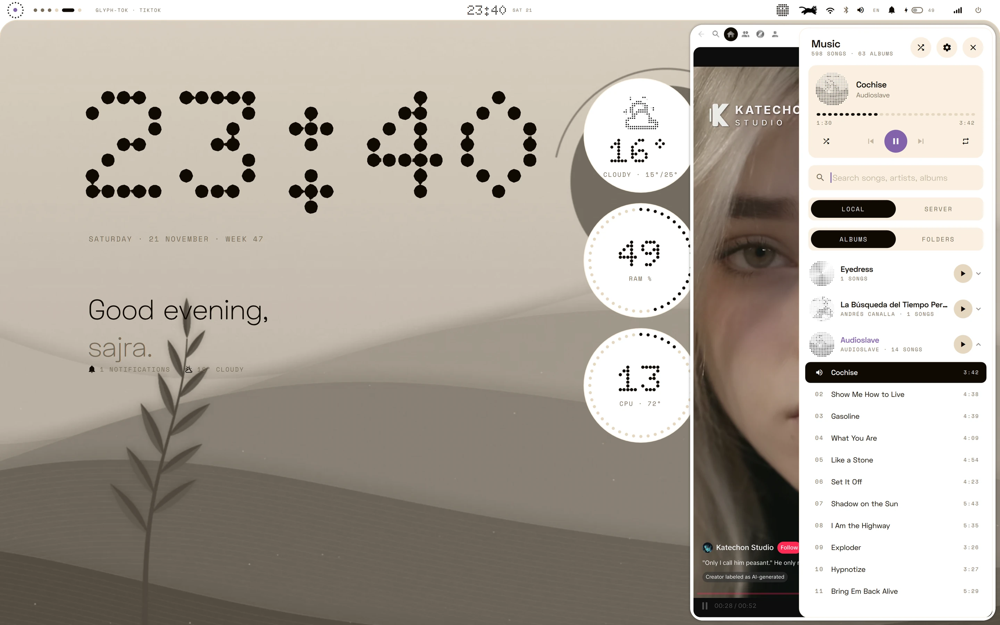 **Music** | 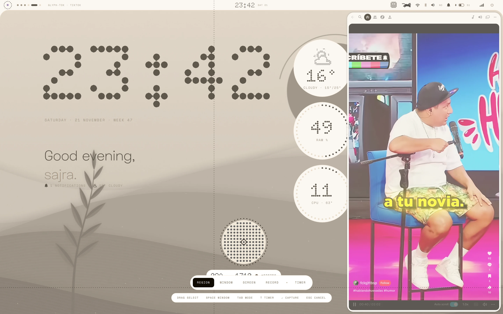 **Shot** |
| 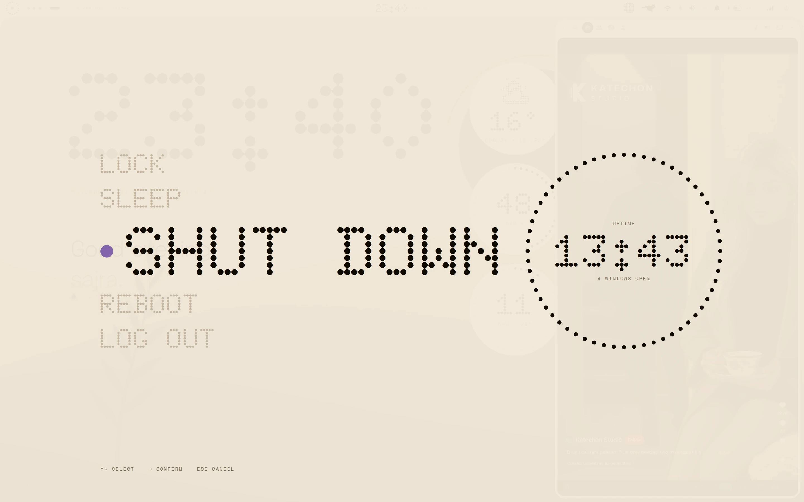 **Power** | 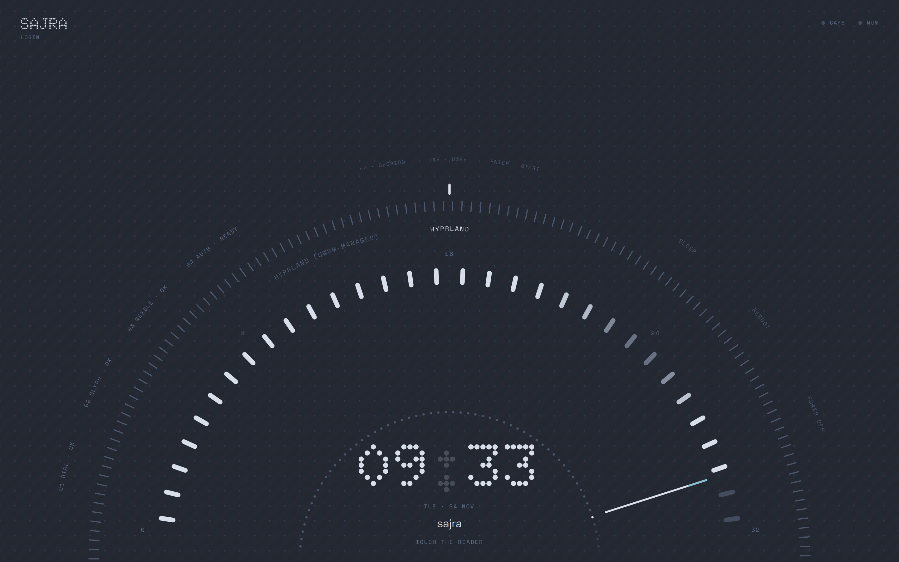 **Login** |

The bar is in **hug** style (Prefs → BAR) with a light palette. On the right is **glyph-tok** in dock mode: TikTok in a
phone-shaped window that keeps its strip on every workspace.

<div align="center"></div>

<h2 align="center">Install</h2>

```sh
git clone https://github.com/cbranty/sajra-rice ~/.local/share/sajra-rice
cd ~/.local/share/sajra-rice
./install.sh                  # Arch: packages, services, symlinks, login theme
./install.sh --with telegram  # same, components picked up front (--with "" for the rice only)
./install.sh --with hanami    # same, with the Hanami assistant (from a release, when there is one)
./install.sh --hanami-build   # same, building Hanami from hanami/ (Rust, Node, tauri-cli; takes a while)
./install.sh --links          # any distro: symlinks only
./install.sh --sddm           # login theme only (sudo); run again after editing it
./install.sh --dry-run        # print every action, change nothing
./install.sh --help           # all the flags
```

The symlinks point into the clone, so keep it where you cloned it.

The installer is a terminal UI made with [gum](https://github.com/charmbracelet/gum) (it offers to install it from
`extra/gum` first): a welcome screen with what it detected (distro, GPU, laptop, fingerprint reader), a component
picker, then each step with a spinner and a counter: pacman, yay and the AUR, components, symlinks, services, Hanami,
the login theme, and a summary with the next steps. Command output goes to
`~/.local/state/glyph/install-<date>.log`; when a step fails it shows the last lines and asks whether to retry it on
screen, continue or stop. `--yes` asks nothing (defaults, plain text, as without a terminal); `--dry-run` prints the
commands instead of running them, without sudo.

Without `--with` it asks which components to add: `hanami` (below), `tok` (glyph-tok, built from
`apps/glyph-tok` into `~/.local/bin`), `telegram` (`Super` `D`), `spotify` with Spicetify
(`Super` `M`), `vault` (Vaultwarden through rbw and rofi, `Super` `Alt` `P`), `clash` for the VPN panel.
Old configs go to `~/.dots-backup-<date>/`. Wallpapers are read from `~/Pictures/Wallpapers`,
gifs for the home cat tile from `~/Pictures/Gifs` (pick one in prefs → home, or click the tile; none there — the cat).

**Hanami** (optional) is a voice assistant on the desktop: `Ctrl` `Alt` `Space` to talk to it, hold `Ctrl` `Alt` `D`
to dictate into any app, and it can read and type into windows and kitty. Sign in to Claude in its panel; the voice
models (~1 GB) download on first use. It is installed from a `.deb` through `packaging/hanami-bin/PKGBUILD`: the
latest release of this repository, a local file (`--hanami-deb <file>`), or one built from [`hanami/`](hanami/) by
`--hanami-build`. It is turned on by two
gitignored links the installer makes: `hypr/hanami-enabled.lua` → `hanami.lua` (keys and autostart, loaded by
`user.lua`) and `kitty/hanami.conf` → `hanami-remote.conf` (kitty's remote control over a private socket). Delete
both, or run `install.sh --no-hanami`, to turn it off. Hanami is a modified version of
[Roamies](https://github.com/KenKaiii/Roamies) by Ken Kai, under the [AGPL-3.0](https://www.gnu.org/licenses/agpl-3.0.html).

Its settings open as a glyph side panel (`quickshell/glyph/hanami/`): `Ctrl` `Alt` `H`, `qs ipc call hanami toggle`,
or Hanami's own tray and `hanami --panel`. It has the pages of Hanami's web panel (which other desktops keep): Home,
Memory, Model, Appearance, Voice, Money, Behavior and About. It talks to Hanami over
`$XDG_RUNTIME_DIR/roamies/panel.sock` (JSON lines) and waits quietly while Hanami isn't running. Its looks (the header, the
Appearance tiles, Ken on About) play from sprite sheets Hanami draws with its own drawing code while the panel shows.

| `config/` | goes to |
|---|---|
| `hypr/` | `~/.config/hypr` |
| `quickshell/glyph/` | `~/.config/quickshell/glyph` |
| `quickshell/rice/` | `~/.config/quickshell/rice`, `~/.local/bin/rice` |
| `quickshell/glyph/term/` | `starship.toml` `fastfetch/` `btop/` `cava/` `gtk-*/gtk.css` `qtengine.colors` in `~/.config` (with a Style colour — copies in `~/.local/state/rice/glyph`; edit `term/`) |
| `kitty/` `qtengine/` | `~/.config/…` |
| `fish/` | `~/.config/fish` |
| `fonts/` | `~/.local/share/fonts/glyph` |
| `sddm/glyph/` | copied to `/usr/share/sddm/themes/glyph` (the `sddm` user can't read your home), set in `/etc/sddm.conf.d/zz-glyph.conf`; to undo, delete both |

Monitor, backlight, GPU and sensors are detected. Keyboard layouts are in `hypr/hyprland/input.lua`,
default apps in `hypr/variables.lua`. Earbuds photo: `quickshell/glyph/buds/<device-name>.png`.
Your own binds and overrides go in `hypr/user.lua`: it's gitignored, so `git pull` never touches it.
Apps for the special workspaces and the editor are read when you press the key, so `user.lua` can swap them:

```lua
local apps = require("variables").apps
apps.editor = "codium"              -- Super Shift K, empty by default
apps.todo   = "planify"             -- Super R, empty by default
apps.music  = "spicetify watch -s"  -- Super M, spotify-launcher by default

hl.bind("SUPER + G", hl.dsp.global("shell:game"))  -- game mode has no key by default
```

<div align="center"></div>

<h2 align="center">Machine-specific</h2>

The installer applies what fits the machine and leaves the rest to you:

- **ThinkPad power LED** — when `/sys/class/leds/tpacpi::power` exists, `install.sh` installs
  [`system/udev/90-thinkpad-power-led.rules`](system/udev/90-thinkpad-power-led.rules) so the lock screen can light it.
- **Battery charge limit** — `glyph-charge-setup` (linked to `~/.local/bin`) installs its udev rule when you first set a
  limit in Prefs → POWER.
- **x1sound** (ThinkPad X1 Carbon Gen 9 only, Realtek ALC287 `17aa:22d5`) — not run by `install.sh`: it touches the
  codec's DAC routing and needs Lenovo's Dolby impulse response, which can't be redistributed. Follow
  [x1sound/README.md](x1sound/README.md): `sudo x1sound/hw/phase2-root.sh`, reboot, then `x1sound/install.sh`.
  Prefs → SPEAKERS is already in the shell and stays empty without it.
- **Fingerprint for sudo and login** — not automated (it edits PAM). If you want it, add
  `auth sufficient pam_fprintd.so` as the first `auth` line of `/etc/pam.d/sudo` and `/etc/pam.d/sddm`, after
  `fprintd-enroll`.
- **Qodi Music server** — optional, for the music panel's **Server** tab: see
  [cbranty/qodi-music](https://github.com/cbranty/qodi-music).

<h2 align="center">Dependencies</h2>

| | |
|---|---|
| **Shell** | `quickshell` 0.3.1+ (Qt 6.9+) · `hyprland` 0.56+ · `hypridle` · `hyprsunset` · `xdg-desktop-portal-hyprland` · `jq` · `curl` · `python3` · `libqalculate` |
| **System** | `sddm` 0.21+ (Qt 6 greeter) · `networkmanager` · `bluez` · `pipewire` · `pipewire-pulse` · `pipewire-alsa` · `wireplumber` · `upower` · `power-profiles-daemon` · `brightnessctl` · `libnotify` · `playerctl` · `polkit-gnome` · `gnome-keyring` · `geoclue` |
| **Capture** | `grim` · `slurp` · `imagemagick` · `libvips` · `gpu-screen-recorder` · `cliphist` · `wl-clipboard` |
| **Terminal** | `kitty` · `fish` · `starship` · `fastfetch` · `btop` · `cava` · `eza` · `zoxide` · `direnv` |
| **Look** | `papirus-icon-theme` · `adw-gtk-theme` · JetBrains Mono Nerd Font · `noto-fonts-emoji` (Emoji 17) · `noto-fonts-cjk` · Bibata · `qtengine` · `darkly` |
| **sajra-rice** | `mpv` · `mpv-mpris` · `ffmpeg` (music) · `aria2` (downloads) · `showmethekey` (keystroke overlay) |
| **Optional** | `cloudflare-warp-bin` · `clash-verge-rev` · `nvidia-utils` · `ydotool` · `hyprpicker` · `swappy` · `trash-cli` |

From the AUR only `qtengine`, `darkly`, Bibata and Zen, plus Spicetify and Clash Verge if picked; all optional. The VPN panel expects Clash Verge in English.
NixOS: change the `/usr/lib` agent paths in `hypr/hyprland/execs.lua` and the Papirus path in `quickshell/rice/rice`. Take `quickshell` from nixos-unstable: 26.05 ships 0.3.0, where Prefs → AUDIO crashes the shell.

<div align="center"></div>

<h2 align="center">Colours</h2>

<div align="center">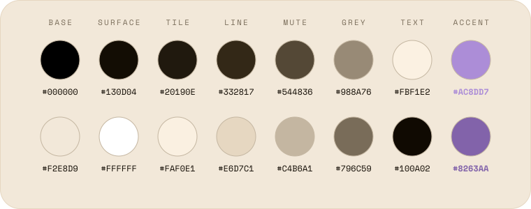</div>

<br>

Dark and light. Red marks the one live thing on screen.
Fonts: Doto, Space Grotesk, Space Mono, JetBrains Mono Nerd Font.

<div align="center"></div>

<h2 align="center">Inspiration</h2>

- [**Nothing OS**](https://nothing.tech): the look and the Glyph lights.
- [**Doto**](https://github.com/oliverlalan/Doto): the dot matrix font.
- [**Gadgetbridge**](https://codeberg.org/Freeyourgadget/Gadgetbridge): the earbuds protocol in `glyph/ear`.
- [**Caelestia**](https://github.com/caelestia-dots/shell): the shell I used before; the deck and hardware detection follow it.

<div align="center"></div>

<h2 align="center">License</h2>

[GPL-3.0](LICENSE), including `x1sound/`. [`hanami/`](hanami/) is under the [AGPL-3.0-only](hanami/LICENSE).
Fonts are under the [OFL](config/fonts/OFL.txt), cava shaders keep their MIT headers.
Nothing, Nothing OS and Glyph are trademarks of Nothing Technology Ltd; this is a fan project, not affiliated with Nothing.

<div align="center"></div>

<div align="center">

```
ᓚᘏᗢ  · · ·
```

```
⠀⠀⠀⠀⣰⣶⣦⣄⡀⠀⠀⠀⠀⠀⠀⠀⠀⠀⠀⠀⠀⠀⠀⢀⣤⣶⣶⡆⠀⠀⠀⠀
⠀⠀⠀⢠⣿⣿⣿⣿⣿⣦⡀⠀⠀⠀⠀⠀⠀⠀⠀⠀⠀⣠⣶⣿⣿⣿⣿⣿⠀⠀⠀⠀
⠀⠀⠀⢸⣿⣿⣿⣿⣿⣿⣿⣦⡀⠀⠀⠀⠀⠀⠀⢀⣾⣿⣿⣿⣿⣿⣿⣿⡆⠀⠀⠀
⠀⠀⠀⢸⣿⣿⣿⣿⣿⣿⣿⣿⣿⣄⣀⣀⣀⣀⣰⣿⣿⣿⣿⣿⣿⣿⣿⣿⡇⠀⠀⠀
⠀⠀⠀⢸⣿⣿⣿⣿⣿⣿⣿⣿⣿⣿⣿⣿⣿⣿⣿⣿⣿⣿⣿⣿⣿⣿⣿⣿⡇⠀⠀⠀
⠀⠀⠀⠸⣿⣿⣿⣿⣿⣿⣿⣿⣿⣿⣿⣿⣿⣿⣿⣿⣿⣿⣿⣿⣿⣿⣿⣿⠁⠀⠀⠀
⠀⠀⠀⠀⢿⣿⣿⣿⣿⣿⡿⢿⣿⣿⣿⣿⣿⣿⣿⣿⠿⣿⣿⣿⣿⣿⣿⡏⠀⠀⠀⠀
⠀⠀⠀⠀⣼⣿⣿⣿⣿⡏⠀⠀⢹⣿⣿⣿⣿⣿⣿⠃⠀⠀⣿⣿⣿⣿⣿⣆⠀⠀⠀⠀
⠀⠀⠀⣸⣿⣿⣿⣿⣿⣷⣀⣀⣼⣿⣿⣿⣿⣿⣿⣦⣀⣠⣿⣿⣿⣿⣿⣿⡆⠀⠀⠀
⣀⣠⣤⣿⣿⣿⣿⣿⣿⣿⣿⣿⣿⣿⣿⣿⣿⣿⣿⣿⣿⣿⣿⣿⣿⣿⣿⣿⣷⣤⣀⡀
⠻⠿⠛⣿⣿⣿⣿⣿⣿⣿⢿⣿⣿⣿⣷⠀⢀⣿⣿⣿⣿⣿⣿⣿⣿⣿⣿⣿⡟⠛⠿⠇
⠀⢀⣠⣾⣿⣿⣿⣿⣿⣿⡈⢿⣿⣿⣿⠃⠸⣿⣿⣿⡿⢰⣿⣿⣿⣿⣿⣿⣷⣄⠀⠀
⠀⢿⠿⠋⢻⣿⣿⣿⣿⣿⣷⣄⣉⣉⣡⣾⣧⣈⣉⣉⣴⣿⣿⣿⣿⣿⣿⠏⠙⢿⡗⠀
⠀⠀⠀⠀⠀⠻⣿⣿⣿⣿⣿⣿⣿⣿⣿⣿⣿⣿⣿⣿⣿⣿⣿⣿⣿⣿⠏⠀⠀⠀⠀⠀
⠀⠀⠀⠀⠀⠀⠈⠻⣿⣿⣿⣿⣿⣿⣿⣿⣿⣿⣿⣿⣿⣿⣿⡿⠟⠁⠀⠀⠀⠀⠀⠀
⠀⠀⠀⠀⠀⠀⠀⠀⠀⠉⠛⠻⠿⢿⣿⣿⣿⣿⠿⠿⠟⠛⠉⠀⠀⠀⠀⠀⠀⠀⠀⠀
```

</div>

## Credits

sajra-rice is maintained by Carlos Branty Conza Mendoza ([@cbranty](https://github.com/cbranty)). It is a modified
version of [glyph-rice](https://github.com/Nebelung-cloud/glyph-rice) by Nebelung and its contributors (GPL-3.0), whose
history this repository keeps. Hanami is a modified version of [Roamies](https://github.com/KenKaiii/Roamies) by Ken Kai
(AGPL-3.0-only); what changed is listed in [hanami/NOTICE](hanami/NOTICE). Thanks to
[Caelestia](https://github.com/caelestia-dots/shell) and every project listed in [Based on](#based-on).
